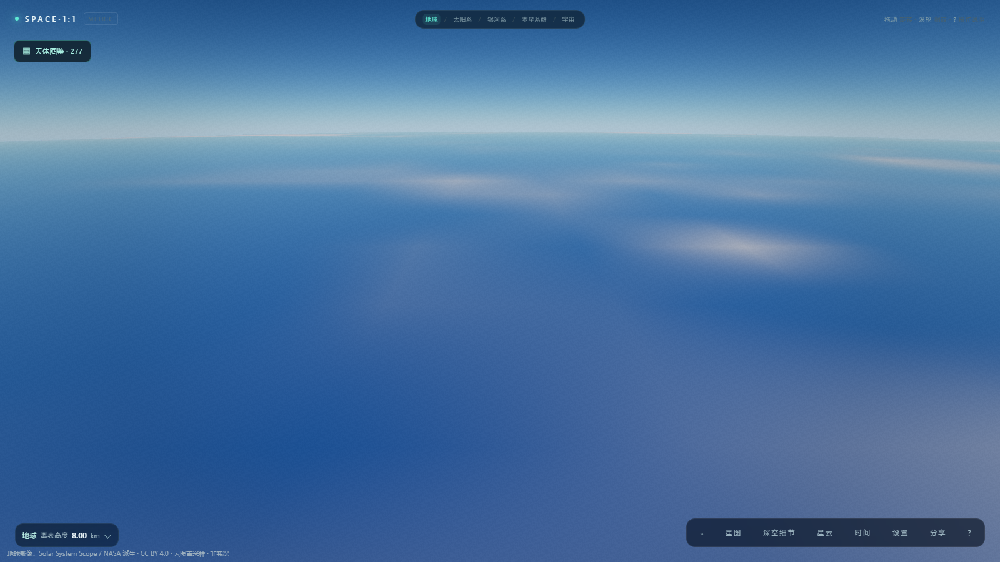
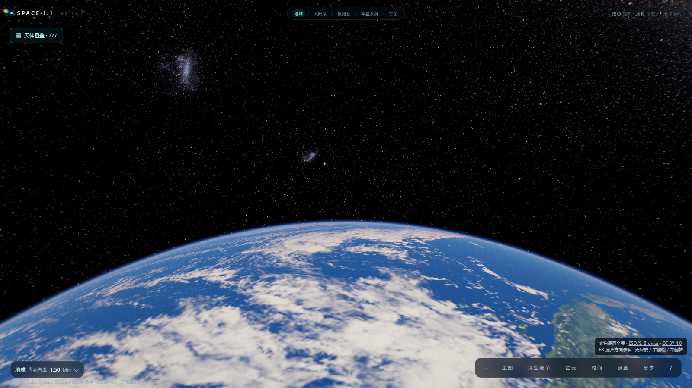

# SPACE·1:1

**从地表米级到 3×10¹² m 的实时宇宙渲染引擎。**
Three.js + 手写 WebGL2 / GLSL，不依赖贴图拼贴——大气散射、体积云、行星环、黑洞引力透镜都是自己算的。


*8 km 高空俯视：分层体积云 + Bruneton 大气散射*


*1.5×10⁶ m 轨道视角：云、大气边缘、晨昏线、麦哲伦云*

---

## 这个项目解决什么问题

在浏览器里做「全尺度」宇宙，最难的不是内容量，是三件事：

1. **精度**：float32 在 10¹² 尺度下有效精度只剩米级，贴地会抖动、Z-fighting、模型撕裂。
2. **光照一致性**：天空、云、地表必须共用同一个物理光照模型，否则一眼假。
3. **性能**：同一套代码要同时撑住贴地 14 m 的 overdraw 和太空的星点填充率。

项目围绕这三点做了 200+ 轮迭代，核心结论都写在 `docs/` 和 `PROGRESS.md` 里。

---

## 关键指标

| 维度 | 数值 |
|---|---|
| 缩放范围 | 地表米级 → **3×10¹² m**（≈14 个数量级），贴地推镜到 3e12 用 2.8 s |
| 核心引擎 | `public/js/app.js` **22,667 行**（另 15 个功能模块） |
| 渲染预算 | high 档 **221 draw call / 30.4 万三角形** |
| 黑洞特写 | 逐像素测地线积分（160 步）**1.0 ms / 帧** |
| 真实数据 | Gaia DR3 **390,534 条**、Cassini UVIS τ **65,985 样本**、天体档案 **268 条** |
| 自动化测试 | **115 个**脚本（源码契约 / CPU 数值 oracle / 像素回归 / 打包一致性） |
| 交付形态 | 单文件 400 MB（`file://` 双击可跑）／HTTP 分离资源 26 MB |

---

## 技术要点

**① 14 个数量级的深度精度**
浮动原点（相机恒在原点附近重建世界坐标）+ 三层尺度（地表 / 行星 / 宇宙）+ 四叉树 LOD + T-junction 缝合。地形细节（AO、沙滩、米级噪声）按像素足迹逐档淡出，避免远处摩尔纹。

**② 物理大气 + 分层体积云**
Bruneton 式透射率 / 单次散射 LUT + 32×64 多次散射迭代（暮光在太阳 −10° 时真实成形）。体积云分两层：积云 2.3–5.3 km、卷云 8.2–11.5 km，各自 march、视差、漂移；沿太阳方向 light march 做自阴影，前向/背散双瓣相函数。掠射角走样用「步长上限 + 步长感知频率淡出 + 云层地形深度测试」三层治理。

**③ Schwarzschild 黑洞光线追踪**
每像素反向积分测地线（曲率限步 midpoint RK2，400 步上限）。阴影边缘用守恒量 impact parameter `b=|r×v|` 与临界值 `3√3/2` 做解析抗锯齿；吸积盘含差速旋转、多普勒 beaming、引力红移、黑体色阶。

**④ 真实数据管道**
Gaia DR3 经 TAP 查询（G≤10、视差 S/N≥10、RUWE<1.4）筛选 390,534 条，`source_id` 用 uint64 字符串精确保留；Cassini UVIS 1 km 光深剖面导入 65,985 个有效样本，区段 τ（C 0.106 / B 3.848 / 卡西尼缝 0.110 / A 0.668）与公开量级一致。

---

## 快速开始

```bash
npm run dev          # 起本地服务 → http://localhost:8132
npm run build        # 产出单文件 space.html / index.html（可双击离线运行）
```

**调试开关**：每个视觉特性都有 URL 级 A/B，便于逐像素对照。
例：`?cirrus=0` 关卷云、`?bhBloom=0` 关黑洞辉光、`?glare=0` 关太阳眩光、
`?moonLight=0` 退回常量月光。完整列表见 `PROGRESS.md`。

---

## 项目结构

```
public/js/app.js        渲染引擎主体（22.7k 行）
public/js/*.js          深空/星表/电影化等模块
public/index.html       外壳（开发模式）
server/server.mjs       Node 静态 + 内容服务
server-java/            Spring Boot 用户系统（注册/登录）
tools/                  115 个测试 + 数据烘焙脚本（Python / Node）
docs/                   116 篇技术文档，逐轮记录「证明了什么 / 没证明什么」
build.mjs               单文件构建（内联 three + 数据）
```

---

## 数据来源与许可

- **Gaia DR3** — ESA / Gaia / DPAC，经 Heidelberg ARI TAP 查询。许可 **CC BY-NC 3.0 IGO**（非商业）。
- **Cassini UVIS** — NASA / PDS Ring-Moon Systems Node。
- **星系实拍** — ESA / ESO 公开影像（6K 原片按需）。
- **球状星团** — Harris 星表 + VizieR。
- 代码以 **MIT** 发布，但上述数据/影像仍受各自许可约束。

---

## 边界声明

这是一个**实时近似**引擎，不是物理仿真器：

- 黑洞是 **Schwarzschild 近似 + 电影化吸积盘**，不是旋转 Kerr 解，也不是该天体的实拍。
- 大气与云是**单次/多次散射近似**，没有完整 MHD 或辐射输运。
- 深空天体是基于公开数据的**重建可视化**，不是逐星扫描。
- 8K 地表纹理赤道约 4.9 km/texel，贴近只放大影像，不会生成不存在的细节。

项目文档对每一轮的「已证明 / 未证明」都有明确标注——这比宣称「完美还原」更接近工程实际。

---

## License

代码：[MIT](LICENSE) © 2026 hesitoleya
数据与影像：见上节各自许可。
