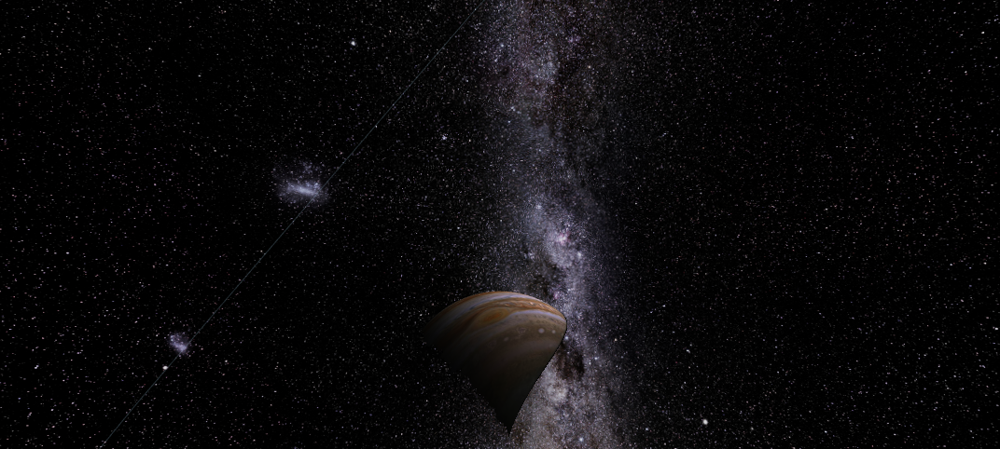
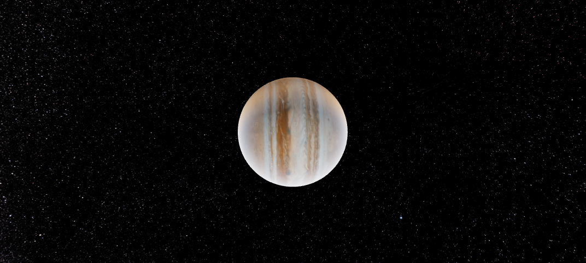
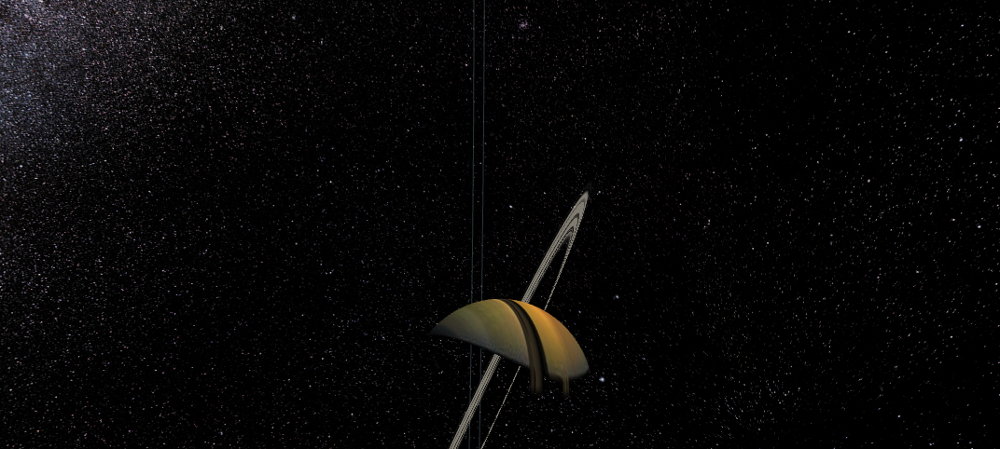
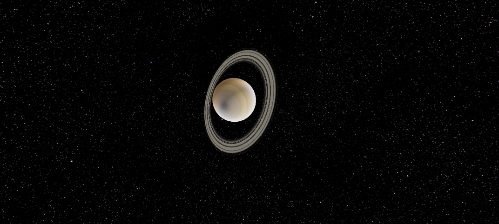

# v241 — 行星三维球体（可拖动旋转）

## 用户的问题

「土星、木星、月球、海王星、金星，都只是真实的二维图片，我想做成三维的球体，鼠标点击拖动能转动，看不同的方向。」

## v240 到底做了什么，为什么看起来还是二维

v240 把图鉴里的任务观测图（Cassini 的土星、Juno 的木星、MESSENGER 的金星等）
**正交投影**到一颗球的**前半球**上：

```glsl
if (uMapReady < 0.5 || vObj.z < 0.0) discard;   // 只画朝相机的半个球
vec2 uv = vObj.xy * 0.5 + 0.5;                  // 圆盘照片直接当 UV
```

这套做法有两个后果，实测截图里很清楚：

| 改前（v240） | 改后（v241） |
|---|---|
|  |  |
|  |  |

1. **轮廓是「弯起来的纸」**。半球壳从侧面看是碗形/斗篷形，木星、金星都呈明显
   的「锅盖」轮廓，不是球；
2. **转过去就空**。`vObj.z<0` 全被 discard，拖动超过 90° 后剩下的是透明的空气——
   这正是用户觉得「只是一张二维图片」的直接原因。

一句实话：v240 的注释写着「这是可旋转的三维球体，不是相机前的平面卡片」，
从数据结构上说没错，从观感上说错了。

## v241 的做法

### 1. 换成全球反照率图，铺满整颗球

| 天体 | 贴图 | 分辨率 | 来源 / 许可 |
|---|---|---|---|
| 金星 | `planet-maps/venus.jpg` | 2048×1024 | Solar System Scope（CC BY 4.0） |
| 木星 | `planet-maps/jupiter.jpg` | 4096×2048 | 同上 |
| 土星 | `planet-maps/saturn.jpg` | 4096×2048 | 同上（不含环） |
| 海王星 | `planet-maps/neptune.jpg` | 2048×1024 | 同上 |
| 月球 | `data/lroc_color_4k.jpg` | 4096×2048 | NASA SVS 4720 / LROC WAC（沿用 v240） |

这些是**等距圆柱（2:1）全球拼图**，不是把一张任务照片绕一圈。区别很重要：
单张照片只记录了一个半球，用它在球上重复/镜像会造出并不存在的经度；
全球拼图本身是轨道器多圈影像拼起来的，背面有真实（虽然分辨率较低）的依据。
`public/data/planet-maps/manifest.json` 记录了每个文件的下载地址、维度、图层含义
和它**不能**声称的东西。

### 2. 贴图挂在行星自己的材质上，而不是再加一个图层

v240 的做法是额外建一颗 `SphereGeometry(1.006)` 的「照片球」，和程序化球二选一显示。
v241 直接把 `uMap` 加进 `makePlanetMaterial` 的 uniforms：

```glsl
vec3 albBase = alb * uTint;
if (uMapReady > 0.5) albBase = mix(albBase, texture2D(uMap, vUv).rgb * uMapGain, uMapReady);
alb = albBase;
```

好处：
- 只有一套几何、一次绘制，不会出现「照片球」和程序球的双层轮廓；
- 光照（`uSunDirW`）、大气临边、晨昏线软化全部复用原有代码；
- `uMapReady=0` 时逐像素退回原来的程序化表面，所以加载失败 / 还没加载完都有兜底。

同时把程序化「表面起伏」（噪声法线扰动）在有贴图时关掉：那层噪声跟图上的
云带/地貌对不上，只会把真实表面搞成塑料疙瘩。

### 3. 夜面补光（明确的观感妥协）

纯物理光照下，从背光一侧看这颗球就是一张黑饼——用户拖动想「看不同方向」，
结果看到全黑，等于白做。所以给夜面加了一层随太阳高度淡出的补光：

```glsl
float mapFill = smoothstep(-0.85, 0.15, ndlRaw) * 0.34;
if (uMapReady > 0.5) ndl = max(ndl, mapFill);
```

最暗约为受光面的 1/3，晨昏线仍然清楚。**这不是物理辐照**，是让「拖动查看」
可用的妥协，写在这里以免以后被当成辐射模型。

### 4. 拖动交互：点中球面才转球

v240 的 `PHOTO_DRAG` 是「视野里只要有一颗可见的观测行星就劫持拖动」，
在太阳系全景里会让人转不动相机。v241 改成真正做命中测试：

```js
GLOBE_DRAG.body = pickGlobe(e.clientX, e.clientY);   // Raycaster 打 visible 的球
```

- 打在球上 → 拖的是球：`gYaw += dx*k`（+Y 自转，表面跟着手走）、
  `gPitch = clamp(...±1.45)`（俯仰，不翻过头）；
- 打在空处 → 拖的还是相机，行为与原来一致；
- 松手留惯性：按松手瞬间的角速度继续转，0.55 s 时间常数衰减；停住超过 140 ms
  再松手则不给速度（否则球会自己滑走）；
- 偏移量存在天体自己身上（`b.gYaw/gPitch`），离开再回来仍是用户转到的那个面；
- 月球同样可拖（`MOON.gYaw/gPitch`），叠加在潮汐锁定的自转上。

### 5. 月球：LROC 图接管反照率，程序化撞击坑退位

月面细节现在由 LROC 4k 图提供，再叠一层随机程序化坑就是「在地图上凿出跟它
对不上的假地形」。而且坑缘高斯宽度按 `r*0.22` 算，6 km 的坑只有 1.3 km 宽，
比顶点间距（1024 段约 10.7 km）还细，采样后在月面边缘钉出一串孤立小球
（近景截图里的「珠子」）。v241：

- 程序化撞击坑默认关闭（`?moonCraters=1` 可退回旧几何月球做对照）；
- 保留月海（真实位置在朝向地球一面）压平与大尺度起伏，用来撑住轮廓；
- 小于 1.2 个顶点间距的坑不再生成，坑缘宽度钳到 1.2 倍顶点间距。

月球还加了一层 0.035 量级的极弱环境补光——真实月夜只有地照，但纯黑的话
「拖着看背面」什么也看不到。

### 6. 顺带修掉的两个观感问题

- **机位偏下**：`GO.venus/jupiter/neptune/moon` 原来 `pitch=-1.20~-1.25`，
  比正对（-π/2）低 18~21°，行星被压到画面下缘还被切掉。改为 `-Math.PI/2`。
- **土星环被切**：环外缘 2.52R，原来 4.1R 机位下环系张开约 76°，超过 55° 视角。
  退到 8.9R（环系 ~34°），并显式给一个「沿日–土方向抬高到环面上方」的机位方向，
  这样环是张开的椭圆而不是一条线。
- **轨道线横切球面**：轨道线是一条穿过天体位置的细线，近景看像划痕。
  改为只有相机到焦点距离 > 2e10 m（全景）时才显示整组轨道线。
- **月球顶部削平**：有 LROC 图时亮度增益从 1.35 收到 1.10。满月相位下月面均值
  原来顶到 ~232/255（接近削顶），月海层次被压掉，贴图里极淡的 2 px 拼接缝
  也会被放大成一道横线。收到 1.10 后峰值落到 ~200，层次回来了，那道线也不再可见。

## 验证

- CPU 契约：`tools/test-v241-planet-globes.cjs`（贴图 2:1、挂载路径、着色器整球采样、
  夜面补光、拖动/惯性/命中、土星环独立、月球坑退位、离线内联、SW 缓存）。
- 实际浏览器（本地后端 + SwiftShader，1072×482 帧）：
  `?auto=0` → `__SE.go('jupiter'|'saturn'|'venus'|'neptune'|'moon')` 逐体贴图就位、
  球体闭合、GL 无错误。成品帧：`v241-venus-globe.png`、`v241-neptune-globe.png`、
  `v241-moon-globe.png`、`v241-saturn-globe.png`。
- 拖动实测：合成 PointerEvent 拖木星，`__SE.moonDebug().globes` 读回
  yaw 0 → 0.792、pitch 0 → 0.22；前后两帧
  （`v241-jupiter-drag-before.png` / `v241-jupiter-drag-after.png`）表面经度明显不同，
  且没有空洞——这正是 v240 做不到的那一步。
- 离线单文件：`node build.mjs --replace-existing` 重建 space.html / index.html /
  space-http.html（153922 KB / 25471 KB），贴图 base64 内联
  （`__ORBIT_INLINE__.planetMaps`）；真正 `file:///D:/WB/orbit/space.html` 打开后
  四张图 ready、0 错误、控制台干净，见 `v241-offline-jupiter.png`。
- SW：`space11-v241-planet-globes-r1`，预缓存四张全球图。
- 回归：`test-v240-planet-observations`（改为后继契约）、`test-atlas-photographs`、
  `test-cosmic-depth`、`test-cosmic-population`、`test-gaia-built` 通过；
  `test-atlas-planets` 的 `amGrid` 旧断言仍失败，与本版无关（catalog.html 未改动）。

## 边界（不要越界声明）

1. 这是**全球反照率图**，不是实时大气、不是辐射定标产品。金星/海王星只有 2k 源，
   细节有限；木星/土星的带纹是任务影像拼接的全球近似，不代表某一时刻的真实流场。
2. 夜面那 1/3 补光是观感妥协，不是物理。
3. 土星环仍是独立的程序化几何（1.18R–2.52R），不从贴图里取粒子密度；
   环的细结构（卡西尼缝等）是噪声带近似。
4. 月球仍是「LROC 颜色图 + 近似几何」，不是 16ppd LDEM 真实高程；
   极区含低分辨率填补。
5. 用户要求的「拖动看不同方向」已达到；真实 8K 级表面细节、环粒子物理、
   行星大气动力学仍不在本版范围内。
